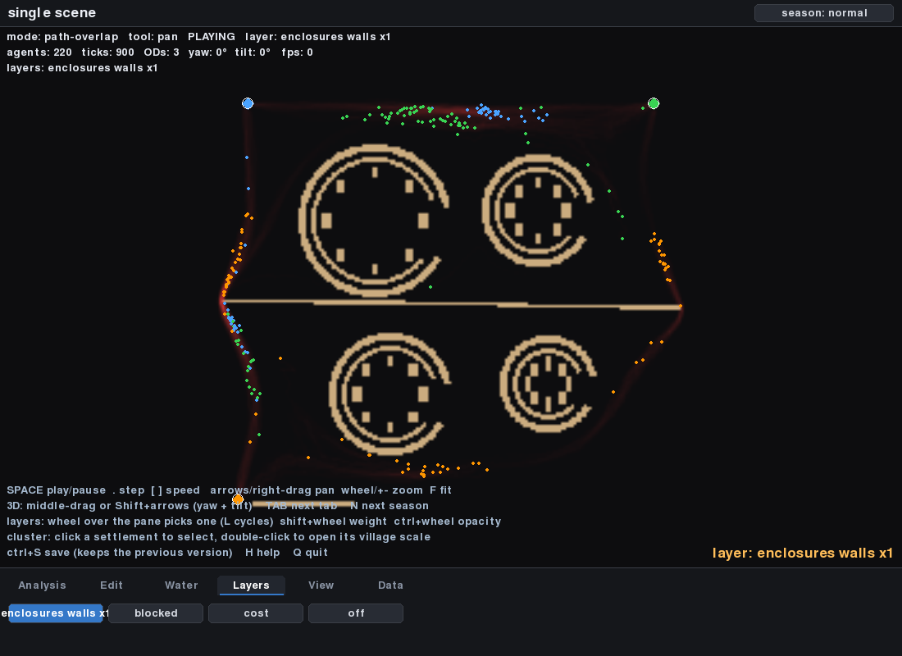

# pedsim — Python pedestrian simulation for ancient sites

`pedsim` is a full Python re-implementation of the Java **PedestrianAgents3D**
model, refocused on ancient cities and settlements (e.g. Göbekli Tepe). It
reproduces the original simulation feature-for-feature and adds
topography-aware routing, simple archaeological importers, and a 3D view.

## Feature parity with the Java edition

Every substantive capability of the original was ported. The table maps Java
features to their Python home.

| Java feature | Python | Notes |
| --- | --- | --- |
| Site boundary + walkability grid | `grid.NavGrid` | inside-site & outside-footprints; `openspace`/`permablocked`/`boundary`/`walkable` |
| Flood-fill distance field (BFS, random diagonal bias) | `NavGrid._bfs` | faithful, incl. the 70/30 orthogonal/diagonal bias |
| **Vision-cone steering** over the flood-fill | `agent.Agent.vision_scan` | ~180° ray fan, far-pixel weighted by longest line-of-sight, neighbour fallback |
| Agent movement / occupancy / target check / renew | `agent.Agent` | speed 0.5, arrival within 3 cells, weighted O/D redraw |
| Agent pool + gradual release | `Simulation.release_agents` | `NUM_AGENTS`, `release_rate` |
| Occupancy heat map + decay + blur | `NavGrid`, `Agent.mark_occupancy` | decay 0.99, blur 0.5 |
| Visibility / visibility-by-group fields | `NavGrid.visibility`, `visibility_o` | accumulated along sight-lines |
| OD points (weights, groups, max 50) | `od.OD` | `origin_weight`/`dest_weight`/`group` |
| Buildings (3D extruded, height, layer) | `building.Building` | |
| Obstacles (layers: LOW/HIGH/STREETS/WATERBODY/PARK) | `building.Building` | |
| Footprint gridded facade segments | `footprint.Footprint.gridded_segments` | |
| Landmarks (lines + footprints for isovist) | `landmark.Landmark` | |
| Modules (place / rotate+snap / snap-to-insertion) | `modules.ModulePrototype`, `PlacedModule` | |
| DXF import (LINE/POLYLINE/LWPOLYLINE/MESH→footprint) | `dxf.DXFHandler` | reads the shipped `text/*.dxf` |
| Analysis: path overlap | `ANALYSIS_PATHOVERLAP` + `viz.plot_occupancy` | |
| Analysis: facade visibility (+ by group) | `ANALYSIS_FACADE_VIS(_O)` + `viz.plot_facade_visibility` | |
| Analysis: traces (+ by group) | `ANALYSIS_TRACES(_O)` + `traces.Trace` + `viz.plot_traces` | |
| Isovist (2π ray clipping) | `isovist.Isovist` + `viz.plot_isovist` | |
| Edit ODs: add/move/delete/weight | `Simulation.add_od/move_od/delete_od/weight_od` | |
| Edit buildings/obstacles: add/move/delete/height/**split** | `Simulation.add_building/move_building/delete_building/set_building_height/split_building` | polygon split via line cut |
| Partial grid re-rasterisation after edits | `NavGrid.partial_update` | |
| Reset analysis | `Simulation.reset_analysis` | |
| Load/Save ODs (text) | `Simulation.load_ods/save_ods` | same `OD,x,y,z,ow,dw,group` format |
| 3D rendering (extruded buildings, camera) | `viz3d` | terrain surface + extrusions + spinning camera |
| Background thread orchestration | `Simulation.step` | flood-fill + release + traces + decay per tick |

### New beyond the original

- **Topography-aware routing** (`topography.Topography` + `TerrainCost`): a
  slope-weighted Dijkstra using **Tobler's hiking function**, so uphill costs
  effort and agents avoid/contour around hills.
- **Weighted landscape layers** (`layers.Layer` + `LayerStack`): rivers, scrub,
  marsh or rasterised walls as named, separately re-weightable influences on
  movement, viewable and adjustable live in the viewer.
- **Seasonal rivers** (`rivers.River` + `Season`): watercourses that are both an
  obstacle to cross and an attractor to follow, and that change between the two
  with the season — a dry bed in summer, a wall in the spring melt.
- **Two scales in one app** (`app.TwoScaleApp` + `scenes`): the settlement
  cluster, where relief and water drive the routes, and the individual village,
  where walls do — navigate between them, with prompted, versioned saves.
- **Real georeferenced input** (`geo`): Copernicus DEM tiles and HydroRIVERS
  hydrography resampled into the simulation's local metric frame.
- **Simple archaeological importer** (`load_site`): tag outlines as
  `source`/`sink`/`building`/`wall`.
- **Terrain relief in the 3D view** — the Java ground plane was flat.

## Is it 3D?

The Java *simulation* was always 2D on the ground plane (agents move in x/y
only); its *rendering* was 3D (extruded buildings in a tilt/rotate/zoom OpenGL
camera). `pedsim` keeps the faithful 2D simulation and provides the 3D **view**
via `pedsim.viz3d` (`render_3d_scene`, `animate_3d`): extruded buildings, ground
obstacles, ODs and agents over an optional terrain surface, with a rotating
camera animation.

## How the agents move (important)

Agents are **not** perfect shortest-path followers. Each tick an agent casts a
~180° cone of straight sight-lines across the flood-fill cost field; each ray
stops at the first wall, and every visible cell with a lower cost-to-target
becomes a candidate. A weighted random draw favouring the **longest clear line
of sight** picks the waypoint it heads for (local search fallback, else "lost").
This produces natural, wandering, sight-line-driven crowds.

One consequence matters when you use friction (below): the cost field alone
cannot deflect anybody, because agents beeline to the farthest *visible* cheaper
cell. So each sight-line also accumulates the **extra cost of the going it
crosses** (`NavGrid.step_penalty`) and a waypoint is only accepted when the cost
it saves covers that. Without rough ground the penalty is zero and the rule
reduces to the original one, so flat scenes behave exactly as before.

## Topography (Tobler's hiking function)

With a `Topography` attached, per-step cost is `horizontal_distance / speed`
where `speed = base·exp(-slope_factor·|slope + slope_offset|)`. Steeper than
`impassable_slope` is blocked. Raise `slope_factor` to avoid hills more strongly.

The cost is **directional**: `dz` is the rise in the direction actually walked,
so climbing a terrace edge and dropping off it cost different amounts (Tobler's
curve peaks at a gentle *downhill*, `slope = -slope_offset`). `max_ascent_slope`
and `max_descent_slope` set the two limits independently, for ground you can
scramble down but not climb.

## Landscape layers (friction, blocking, elevation)

Beyond walls, what pedestrians feel underfoot is a sum of influences: a river,
marsh, thick scrub, a rasterised wall line. Each is a named `Layer` on the
grid's `LayerStack`, combined additively:

```
friction = 1 + Σ weightᵢ · dataᵢ        # kind="friction"
blocked  = any(dataᵢ > 0)               # kind="block"   (kind="info" = display only)
```

```python
import numpy as np
from pedsim.layers import Layer

river = np.zeros((sim.grid.nx, sim.grid.ny))
river[:, 34:40] = 1.0          # the channel: expensive but crossable
river[20:26, 34:40] = 0.05     # a ford
sim.add_layer(Layer("river", river, weight=12.0, color=(80, 150, 255)))
sim.set_layer_weight("river", 6.0)     # re-weights and re-routes
```

`data` is normally 0..1 (`Layer.normalise()`); `inf` is impassable and `weight=0`
disables a layer without removing it. Which solver builds the cost field depends
on what is present:

| present | solver |
|---|---|
| topography | slope-weighted Dijkstra (directional up/down) |
| friction only | friction-weighted flood fill — **each cell adds its friction, not 1** |
| neither | the faithful uniform-cost BFS flood fill |

In the viewer, the **Layers** row of the control pane lists the stack followed by
read-only views of what the solvers actually consume — `friction` (the combined
array), `blocked`, `elevation` and `cost` (the live cost field) — plus `off`.
With the cursor **over the control pane**:

- **wheel** — choose which layer is drawn (`L` / `Shift+L` cycle too)
- **shift+wheel** — change the selected layer's weight; routes rebuild immediately
- **ctrl+wheel** — overlay opacity

Weights show on the buttons (`river x2.5`) and in the HUD, so you can dial a
river's cost up and down and watch the crossing points move.

## Interactive viewer

`pedsim.viewer.Viewer` (pygame) is a live, top-down viewer — the interactive
counterpart of the original OpenGL sketch. It runs the simulation in real time
and supports pan/zoom, analysis-mode switching, click editing and an isovist
viewpoint:

```bash
python examples/run_viewer.py                    # two-scale Taş Tepeler app (default)
python examples/run_viewer.py --scene dxf        # original scene
python examples/run_viewer.py --scene gobekli    # single topography scene
```

### Layout

A **top bar** carries the scale breadcrumb (and the `< cluster` button when you
are inside a village), the settlement you have selected, the current **season**,
and an `unsaved edits` marker. A **tabbed control pane at the bottom** holds
every action as a clickable button — all the same width, so the pane reads as a
grid rather than a ragged row:

| Tab | Buttons |
| --- | --- |
| **Analysis** | none · path overlap · facade vis · facade group · traces · traces group · reset analysis · reset all |
| **Edit** | source/sink OD · OD weight · delete OD · add/move/height/delete building · add/move/delete obstacle · pan-select |
| **Water** | add river · add ford · delete river · toggle flow · season › · dry · normal · spring floods |
| **Layers** | one button per landscape layer, then `terrain map` · `elevation` · `friction` · `blocked` · `cost` · `off` |
| **View** | fit view · isovist · top-down · ¾ view · rotate left/right · help |
| **Data** | save scene · load scene · versions · save/load ODs |
| **Research** | chronology · time window · undated policy · month · phases by time · task filter · assign phase · one button per phase |

`TAB` cycles tabs. The active mode/tool is highlighted and actions report status
just above the pane.

Add/height/weight tools apply on click; *move* grabs an item then drops it on the
next click; *add* (building/obstacle/river) collects vertices. **Close the shape**
by clicking near the first vertex (a ring marks the snap target — it turns green
when you're within range), by **double-clicking**, or by pressing `ENTER`. A
river is a polyline, so two points are enough and the ends are not joined.

### Two scales: cluster → village

The viewer starts at the **settlement cluster** — the whole Taş Tepeler group
over ~80 km, built from the real Copernicus DEM and HydroRIVERS data, with every
usable site from the catalogue drawn as a labelled marker. A **green ring** means
that site has a detailed map; grey means it does not, and the interface says so
rather than opening an empty scene.

Click a settlement to select it, **double-click** (or press the top-bar button)
to drop into its **village scale**, where walls and buildings are the obstacles
rather than the landscape. `< cluster` or `ESC` goes back.

Each scene is built once and cached, so a round trip keeps both your edits and
the accumulated analysis.

### Saving, with versions

Edits mark the scene dirty. Leaving a scale — or quitting — **asks before
discarding**: `save` / `discard` / `cancel` (or `Y` / `N` / `ESC`). `Ctrl+S`
saves at any time.

Saves are versioned. `save scene` writes `<scene>.geometry.json` and rolls the
file it replaced into `<scene>.v001.json`, `v002`, … keeping the last 20. A
reconstruction is an interpretation, and the one you want back is usually the
one you just overwrote:

```python
sim.save_geometry_versioned("gobeklitepe.geometry.json")  # -> "...v003.json" archived
Simulation.list_versions("gobeklitepe.geometry.json")     # oldest first
```

### Seasonal rivers

Most watercourses in the Şanlıurfa steppe are seasonal, so the same channel is a
dry walkable bed in late summer, a costly wade at normal flow, and an impassable
barrier in the spring melt. The **season** button (or `N`) cycles
`dry → normal → spring floods`, re-rasterising every river and re-routing:

| Season | Seasonal course | Perennial course |
| --- | --- | --- |
| dry | disappears — just ground | 40 % of its normal crossing cost |
| normal | 70 % crossing cost, fords usable | full crossing cost |
| spring floods | **blocks** | **blocks**, fords submerged |

A river is both an obstacle and an attractor: the channel *adds* friction while
the bank corridor *subtracts* it, so routes hug the water where following it is
as useful as crossing it. **Fords** are cheap gaps in the channel — the places
traffic funnels through. Add them with the *add ford* tool by clicking on a
channel; *toggle flow* switches a river between seasonal and perennial.

```python
sim.add_river([(150, 0), (150, 300)], name="Mucid Dere", width=24,
              crossing_cost=6.0, attraction=0.3)
sim.add_ford(sim.rivers[0], 150, 60)
sim.set_season(Season.SPRING_FLOOD)
```

### 3D and draw order

You can **orbit the scene in 3D** (like the Java OpenGL camera): **middle-mouse
drag** (horizontal = yaw, vertical = tilt) or **Shift+arrows** (Left/Right yaw,
Up/Down tilt). As you tilt, the ground plane (terrain, heatmaps, footprints)
foreshortens and **buildings extrude into shaded prisms**, drawn far-to-near so
nearer walls occlude. Everything rotates together; yaw/tilt are shown in the HUD
and `F` resets pan/zoom/orbit to a top-down view.

**Buildings are the top layer** — they are drawn after the agents, traces and
ODs, so a pedestrian behind a wall is hidden by it. There is no always-on
background raster: the shaded relief map is the `terrain map` entry in the
**Layers** tab, off by default so analysis is never fighting a coloured
backdrop you cannot switch off.

Keyboard shortcuts still work: `SPACE` play/pause · `.` step · `[`/`]` speed ·
arrows / right-drag pan · Shift+arrows or middle-drag orbit (yaw + tilt) · wheel
or `+`/`-` zoom · `F` fit/reset · `0`-`5` analysis modes · `C` reset analysis ·
`O` add source-OD · `K` add sink-OD · `X` delete · `B` draw building (`ENTER` to
close) · `I` isovist follows mouse · `V` pan tool · `L` cycle layer · `TAB` next
tab · `N` next season · `Ctrl+S` save · `H` help · `ESC` back a scale · `Q` quit.

For headless capture, render a scripted session to frames and encode:

```bash
python examples/run_viewer.py --scene dxf --demo --duration 24 \
    --record-dir /tmp/frames --record-fps 25
ffmpeg -framerate 25 -i /tmp/frames/%05d.png -pix_fmt yuv420p viewer.mp4
```

## Site catalogue & palaeo-terrain (Göbekli Tepe / Taş Tepeler)

`pedsim.sites` is a sourced catalogue of 16 Pre-Pottery Neolithic sites around
Şanlıurfa — the official Taş Tepeler twelve plus Nevalı Çori, Hamzan Tepe, Taşlı
Tepe and Kurt Tepesi. Every entry carries **how well its coordinate is actually
known**, because several are shakier than they look:

```python
from pedsim import sites
sites.located(usable_only=True)   # 13 sites safe to route on
sites.data_gaps()                 # Sefertepe (conflicting), Mendiktepe, Söğüt Tarlası
sites.occupied_at(9000)           # who was there in 9000 cal BC
sites.find("Gre Hut")             # alias lookup -> Ayanlar Höyük
```

Three entries need a decision before cluster-scale work: **Sefertepe** has two
published coordinates 1.6 km apart (both are kept, as `lat/lon` and `alt_coord`),
and **Mendiktepe** and **Söğüt Tarlası** have no published coordinate at all.
Note also that the `Gürcütepe` value circulating on Wikidata and tour sites is
actually Kazane Höyük's — a different, Bronze Age site; there's a regression test
guarding against it being "fixed" back.

`pedsim.paleo` strips post-10 ka valley aggradation from a modern DEM, using the
14 radiocarbon-dated Culap Suyu cores of Nykamp et al. 2021 (open access):

```python
from pedsim import paleo
paleo_dem, uncertainty = paleo.correct_dem(dem, eastings, northings)  # UTM 37N
```

Roughly 0 m on the plateaus, 0.6–0.8 m at slope toes, ~2–3 m across the piedmont
and 1.5–5.3 m in the floodplain — so the correction bites exactly where it
changes routing, since only the valley figures clear GLO-30's 2.2 m vertical
RMSE (`paleo.meaningful()`). Cells with no basis for a correction come back
**unchanged with infinite uncertainty** rather than a quiet zero.

Scope limits are documented in the module and worth reading before trusting
output: there is **no** Holocene data for the Harran plain (and Rosen's Kazane
sequence hints parts of it were eroded rather than buried, so even the sign is
unknown); a modern DEM at Nevalı Çori returns the Atatürk reservoir surface, not
terrain; palaeochannel positions at 10 ka are unconstrained, so rivers should not
be moved; and 10–8 ka is treated as geomorphically stable, which is the published
conclusion as well as the simpler model.

## Importing published site plans (`pedsim.plans`)

At village scale the obstacles are walls, and for these sites the walls exist as
**ink on paper** — figure plates in excavation reports, drawn by hand, none of
them georeferenced. `pedsim.plans` pins such a drawing to the ground with a
**similarity transform** (scale, rotation, translation) you supply, then samples
the ink onto the simulation grid.

Two ways to pin it, matching what plans actually carry:

```python
from pedsim.plans import ControlPoint, Georeference, SitePlan, add_plan_to

# (a) two points whose ground position you know — accurate, solves scale+rotation
geo = Georeference.from_control_points(
    ControlPoint(pixel=(412, 908), world=(0, 0),   label="excavation datum"),
    ControlPoint(pixel=(1180, 655), world=(60, 20), label="grid E60/N20"))

# (b) a scale bar and a north arrow — what most published plates give you
geo = Georeference.from_scale_bar(
    ControlPoint(pixel=(450, 450), world=(0, 0), label="plate centre"),
    bar_pixels=200, bar_metres=20, north_deg=0)

plan = SitePlan.load("plate.png", geo, source="Author 2024, fig. 7")
add_plan_to(sim, plan)                       # walls become impassable
add_plan_to(sim, plan, blocking=False, cost=3.0)   # or merely rough going
```



A similarity transform is deliberate. Affine or projective fits would absorb the
draughtsman's distortion into a skew with no physical meaning, and let one
badly-placed control point silently stretch the plan. A rigid scale-and-rotate
either fits or visibly does not. Check it with a **third** point the fit never
saw — `geo.check([...])` returns the RMS ground error in metres; a two-point fit
is exact on its own points and tells you nothing.

The ink becomes a **layer**, not building footprints. Tracing a hand-drawn wall
into a clean polygon is a separate and unreliable problem; a mask says exactly
what the drawing says — "something is here" — without inventing corners the
draughtsman never drew. And because it is a layer it stays switchable: an
imported plan is an interpretation, so you can re-weight or remove it.

`plan.covered(xs, ys)` distinguishes **"the plan says nothing is here"** from
**"the plan does not reach here"**. Cells outside the image are never imported as
open ground.

## Which settlements actually have a plan? (`pedsim.maps`)

A village scene without walls is just a cropped DEM. `pedsim.maps` records, for
every catalogue site, whether a **usable architectural plan, geophysical raster
or 3D model** exists, and whether it can be pinned with :mod:`pedsim.plans`.
It is a finding aid: the drawings stay with their publishers.

| Site | Best source today | Import? |
| --- | --- | --- |
| **Göbeklitepe** | Clare 2024 *Documenta Praehistorica* 51, Fig. 4 (Kinzel / DAI) — enclosures A–D, trenches L09-* | yes, via the 10 m grid |
| **Nevalı Çori** | Hauptmann 1999 level plans I–III (reproduced in Ercoskun); site now flooded | yes, with two control points |
| **Harbetsuvan Tepesi** | Tada et al. 2026 *Archaeological Prospection* magnetometry/GPR + [Zenodo rasters](https://zenodo.org/records/18979006) | as geophysics, not excavated walls |
| Karahantepe | Karul 2021 TAED 82 — **photographs and a section**, not a measured site plan | not yet |
| Sayburç | Özdoğan 2023 *Antiquity* — drone photo of one building | no |
| Çakmaktepe | Şahin 2025 *Arkeoloji Dergisi* — photos of round houses; line plans likely only in KST | no (photos) |
| Sefertepe, Ayanlar, Hamzan, Gürcütepe, Yeni Mahalle, Taşlı, Kurt | survey notes or paywalled DAI soundings | no verified plan |
| Yoğunburç, Mendiktepe | excavation only just started (2023–26) | no plan yet |
| Söğüt Tarlası | still unlocated | no |

**3D.** A free Sketchfab mesh of the Göbekli hollow exists (rmark, ~400 photos,
3.3 M triangles) — useful as a visual check, not as survey walls. No
downloadable TLS/Open Heritage dataset for these sites was verified.

**Terrain better than GLO-30.** For Nevalı Çori the modern DEM is reservoir
water. The [CORONA Atlas](https://corona.cast.uark.edu/) has georeferenced
1960s ~1.8 m imagery of the pre-Atatürk-Dam valley, free for non-commercial
use. TanDEM-X 12 m and Copernicus EEA-10 exist but need a research proposal /
restricted access.

```python
from pedsim import maps
maps.has_village_plan("Göbeklitepe")   # True
maps.importable("Harbetsuvan Tepesi")  # geophysics + Zenodo URL
maps.summary()                         # one line per site
```

First import to try: **Clare 2024 Fig. 4**. Open-access, labelled DAI 10 m
squares, covers the four special buildings the village simulation is actually
about. Pin two opposite trench corners with :class:`~pedsim.plans.ControlPoint`
and `add_plan_to(sim, plan)`.

## Georeferenced data (`pedsim.geo`, `pedsim.scenes`)

`pedsim.geo` bridges real data into the simulation's flat local metric frame.
`LocalFrame` pins an origin and converts via the right UTM zone (37N here), so
simulation distances are true metres:

```python
from pedsim import geo, sites

frame = geo.LocalFrame.centred_on(sites.bounds(usable_only=True))
topo   = geo.load_dem(geo.dem_tiles("data/raw/Copernicus_DSM_*.tif"),
                      frame, bounds, cellsize=250.0)
rivers = geo.load_rivers("data/raw/HydroRIVERS_v10_eu_shp/HydroRIVERS_v10_eu.shp",
                         frame, bbox, clip=bounds)
ods    = geo.site_ods(frame, sites.located(usable_only=True))
```

DEM tiles are resampled by inverse mapping — every destination cell centre is
converted to lon/lat and sampled — so the output lands exactly on the grid the
simulation wants. HydroRIVERS reaches become `River` objects, with
`DIS_AV_CMS ≥ 0.5` read as perennial and everything else as seasonal.

`pedsim.scenes` assembles the study itself:

```python
from pedsim import scenes
app = scenes.build_app(save_dir=".")   # cluster + the village scenes
sim = app.cluster.sim()                # ~313×257 cells at 250 m, 13 sites, 20 rivers
```

`cluster_scene()` builds the 80 km landscape (GLO-30 terrain, palaeo-corrected
where the Culap cores allow, HydroRIVERS watercourses widened to the valley
floors they really are at this resolution); `village_scene(name)` crops a 1.2 km
box at **2 m** cells around one site, with perimeter gate ODs, ready for a wall plan.
Village scenes are offered only for sites with a **published** coordinate — one
centred on an approximate point would imply a precision the survey data does not
support. Both fall back to synthetic relief if the downloads are absent, so the
viewer still runs on a fresh clone.

Requires `rasterio`, `pyproj`, `shapely` and `pyshp` (all in
`requirements.txt`), imported lazily so the rest of the package works without
them. Data downloads live in `data/raw/` and are gitignored.

## Research layer

The catalogue is [`docs/REQUIREMENTS-research-features_2.md`](../docs/REQUIREMENTS-research-features_2.md).
The model description generated from the scenario defaults is
[`docs/ODD.md`](../docs/ODD.md).

A bare `Simulation` leaves chronology off, so an old scene draws the same trips
as before. A scenario file turns it on. Config tables live in `data/config/`
(population, tasks, calendar, obsidian sources, the synthetic scenario). Dates
are calibrated BC, larger meaning earlier.

```bash
cd python
python -m pedsim.scenario --odd          # rewrite ../docs/ODD.md
python -m pedsim run data/config/scenario_synthetic.yaml --out ../runs
python -m pedsim hypotheses list
python -m pedsim hypotheses run R G --seeds 1
python -m pedsim pack                    # live scene pack + engine bundle into web/
python -m pedsim serve                   # http://0.0.0.0:8000  field client
```

### Field client (`web/`): the model itself, offline

`web/` is the field page for a laptop, phone or tablet. It runs **pedsim
itself** on the device: the Python package is loaded into the browser
([Pyodide](https://pyodide.org), bundled in `web/vendor/pyodide`), and
`pedsim.live.LiveEngine` rebuilds each scene as a real `Simulation` and steps
it. There is no second agent model and nothing is played back.

`python -m pedsim pack` writes what the device needs into `web/`:

| File | What it is |
| --- | --- |
| `packs/goebekli/cluster.json` + `.bin` | the Taş Tepeler cluster: terrain on the 250 m grid, rivers, sites, and the solved routes for all three seasons |
| `packs/goebekli/village-<site>.json` + `.bin` | one 2.5 km scene per site (all 18): 5 m cells with nested 1 m patches, and its solved routes |
| `packs/goebekli/sat-<scene>.jpg` | Sentinel-2 cloudless 2016 (EOX, CC BY 4.0), 10 m pixels: the offline satellite basemap |
| `packs/goebekli/osm-<scene>.geojson` | roads, tracks and place names from OpenStreetMap (ODbL), drawn over the basemap |
| `packs/goebekli/basemap.jpg` | shaded relief rendered from the Copernicus DEM, the fallback basemap |
| `vendor/pedsim.zip` | this package and `data/config`, for the in-browser engine |

A packed scene replays **bit for bit** like the scene it was packed from
(`tests/test_live.py`). A phone cannot read GeoTIFFs or run `pyproj`, so the
laptop resolves terrain and the georeference once and the pack carries the
result. Routes (cost fields) are packed too, so a scene opens in well under a
second; they are re-solved on the device only after an edit that moves a wall
or a place.

The pack and the browser runtime are build output and are not in the source
history. On a fresh clone run `bash ../scripts/fetch_pyodide.sh` once.

```bash
python -m pedsim pack                         # all sites
python -m pedsim pack --save-dir ../out       # include scenes saved in the desktop viewer
python -m pedsim serve                        # http://localhost:8000
```

The satellite and road layers are downloaded when the pack is built and cached
in `data/raw/basemap_cache`; `pedsim pack --no-maps` skips them. Online, the
page draws detailed Esri imagery over the packed image (*Best available*).

**All 18 sites take part.** Sites without a usable coordinate sit on a working
position (`sites.position`): Sefertepe on the first of its two conflicting
values, Mendiktepe, Kocanizam, Söğüt Tarlası and Biris Mezarlığı on a point in
their published search area or read off a published map. They are marked with a "?" and their scene says so. A
working position is a placeholder, not a location.

**Why a site sends no walkers.** With chronology on, a site outside the time
window, an undated site (unless *Undated sites* is set to include them) or a
site with no co-occupied partner sends nobody. The panel lists each such site
with its reason.

**Slope and rivers.** The scenes use a slope exponent of 7.0 (cluster) and 6.0
(village) against Tobler's 3.5, and a river crossing cost of 12. These are
assumptions, set strong so relief and water shape the corridors. *Slope effect*
and *River crossing cost* scale them live; every route is re-solved.

**Walkers go home.** A walker that arrives starts its next trip from the place
it first set out from (`Simulation.respawn_at_origin`, on in these scenes). The
page shows it reappear there with a ring.

In the page: **Cluster** or a site from the list (or tap a site marker).
**▶ Run / ❚❚**, **⏩** (×1, ×2, ×5, ×10 steps per frame) and **↺ Reset**
(restart the run, keep the edits) are in the panel and the toolbar. **P / F / Fx / TR / TRx** are the analysis modes of the
Java tool. **OD+ / OD− / +/−** add, remove and re-weight places; **B○ / B▭ / B−**
add and remove buildings: click the centre (or a corner), move to see the
outline and its size, click again to finish; right-click or Esc cancels. A
building is hollow: a 0.4 m wall around a room, with a door facing the nearest
place and the household's place inside. The routing grid resolves the wall as
one 2 m cell and the doorway as about two; **Iso** shows the isovist from a tapped point.
Every edit goes to the engine and re-routes the walkers. **save / open** keep a
scene's edits on the device, **file** exports them as `<scene>.geometry.json`,
which the desktop viewer and `pedsim pack --save-dir` read. **X** returns the
scene to the pack. Chronology, the time window, the season and the phase boxes
are the same switches as the desktop Research tab. **REC** records a GPS track
(it keeps the screen awake, and stores accuracy and altitude per fix); **GPX**
exports it.

**Image on the ground.** *Add image* (or **IMG**) lays any picture, such as a
plan or a drone photograph, over the map. Drag its four corners to stretch it
onto what the basemap shows, and the white square to move it; *Adjust* shows
the handles again later. It is kept on the device per scene. It is a drawing
aid for placing buildings: the model does not read it.

**Offline.** *Download all* stores the whole pack and the engine on the device
(about 110 MB). The basemap then switches to *Relief (offline)*; Google, Esri
and OpenStreetMap tiles are online-only because their terms forbid storing
them. A phone or tablet only allows offline storage and GPS on an **https**
address (`localhost` on the laptop itself is exempt), so for an iPhone or iPad
either publish `web/` to a static https host or serve it from the laptop with a
certificate the device trusts (`python -m pedsim serve --cert cert.pem --key key.pem`).
`scripts/publish_field.sh` pushes `web/` to the repository's `gh-pages` branch as
one fresh commit, which GitHub Pages serves at
<https://gaschwanden.github.io/PedestrianAgents3D/>. That page is public. On a
static host only the relief basemap is offered, because satellite and street
tiles need the laptop's tile proxy.

**Göbeklitepe from the published plan.** `pedsim.gobekli_plan` reads the 2024
building-phase plan of the southeast hollow (Clare 2024, *Documenta
Praehistorica* 51, Fig. 4; drawing M. Kinzel, DAI) into a 55 x 81 m scene at
0.5 m cells: walls per building phase (eight, PPNA to after MPPNB) as
switchable layers, T-pillars, the four special buildings as places. Put the
plate at `data/raw/plans/gobeklitepe_clare2024_fig4.png`; it is not shipped,
only the wall raster derived from it is. Read this before trusting it:

- the plate gives the order of the phases, not their dates; the dates on the
  time slider are assumptions;
- a wall is taken to stand from its building phase onward;
- stonework the authors left uncoloured is not included, so it is walkable;
- the plan is placed by putting buildings A-D under the middle of the shelter
  roof seen on satellite imagery, good to about 10 m;
- Building C is a closed ring on the plate; an opening is cut on its south
  side, where a U-stone and passage are published.

**Sites from Clare's maps.** Clare (2024) Figs 26-28 are used for three things:
period attributions for sites with no date of their own (marked "possible"),
a working position for Mendiktepe and for the newly added Kocanizam read off
the EPPNB map (about 0.5 km), and the choice between Sefertepe's two published
positions (the map agrees with the second).

**Nested grids: 2.5 km around each site.** A village scene is now 2.5 km
across on 5 m cells, with 1 m cells laid over whatever needs them
(`pedsim.nested`): 50 m tiles around buildings and walls, around every place
that is not a perimeter gate, along rivers, and over any rectangle listed in
`NestedConfig.marked`. Adding a building or a place makes its fine ground.
One route solve runs across both levels, so a path can enter a patch, pass a
1 m doorway and leave again. Things to know:

- a walker sees only its own grid, so sight-lines end at a patch edge;
- a fine walker takes five 1 m-scale steps per tick, a coarse one a single
  5 m-scale step, so both cover the same ground per tick;
- fine cells are capped (`max_fine_cells`, 800,000); what does not fit stays
  coarse and the scene says so;
- the packed routes of these scenes are single precision to keep the download
  down, so a packed village no longer replays bit for bit like the laptop one
  (the cluster and the plan scene still do);
- `village_scene(..., extent_m=5000)` gives 5 km; routes then take about four
  times as long to solve. `fine=None` gives a plain single grid.

**What is not in a village scene yet.** Villages other than the Göbeklitepe
plan are real terrain with six perimeter gates and a centre. Walls and buildings come from a georeferenced
plan (`pedsim.plans`) or are drawn in; none ship. Terrain is the 30 m DEM,
interpolated to the 2 m grid, so it shows the hill, not the architecture.

The desktop Edit tab can box-select buildings (two clicks) and assign them to a
phase. **B circle** / **B rect** place a round or rectangular house in three
taps (centre/rim or corner/corner, then the door); an entrance OD is created
outside the door.
With a regional scene loaded, Escape goes up one level and the breadcrumb reads
`Region › Cluster › Göbeklitepe`.

## Install & run

Use a virtual environment (required on macOS with Homebrew Python, which blocks
global `pip`). Run these from the **repo root**:

```bash
python3 -m venv .venv
source .venv/bin/activate          # Windows: .venv\Scripts\activate
pip install -r python/requirements.txt
```

> The viewer dependency is `pygame-ce` (a drop-in fork of pygame that ships
> wheels for Python 3.13/3.14; it still imports as `pygame`). Plotting/3D output
> works without it.

Then run the examples from the `python/` folder (they locate `text/*.dxf`
automatically; override with `PEDSIM_TEXT=/path/to/text` if needed):

```bash
cd python

# 0) The two-scale Taş Tepeler app (start here). Needs data/raw/ downloaded;
#    without it the scenes fall back to synthetic relief.
python examples/run_viewer.py                       # ~15 s to build the cluster
python examples/run_viewer.py --cellsize 400        # coarser and faster
python examples/run_viewer.py --save-dir ../out     # where versioned saves go

# 1) Full feature showcase on the ORIGINAL DXF scene (text/*.dxf) + 3D:
python examples/run_features.py out
#   -> pedsim_dxf_3d.png, pedsim_dxf_3d_spin.mp4, pedsim_pathoverlap.png,
#      pedsim_facade_visibility[_group].png, pedsim_traces[_group].png,
#      pedsim_isovist.png, pedsim_edit_3d.png, pedsim_topo_3d.png

# 2) Göbekli Tepe topography demo (hill avoidance):
python examples/build_dataset.py
python examples/run_demo.py out

# Tests:
python tests/test_core.py
python tests/test_features.py
python tests/test_layers.py
python tests/test_sites_paleo.py
pytest tests/test_rivers_app.py tests/test_viewer_ui.py tests/test_research.py tests/test_outputs.py
#   or the whole suite: pytest tests
```

### Load the original scene programmatically

```python
from pedsim import Simulation, ANALYSIS_PATHOVERLAP
sim = Simulation.from_dxf(
    "../text/GSite.dxf", "../text/GBuildings.dxf",
    "../text/GObstacles.dxf", "../text/GOD.txt",
    gridsize=4.0, analysis_mode=ANALYSIS_PATHOVERLAP,
)
sim.run(300)
```

### Archaeological site + terrain

```python
from pedsim import Simulation, load_site, load_topography, TerrainCost
site = load_site("site.json")
topo = load_topography("dem.asc")
sim = Simulation.from_site(site, topography=topo,
                           terrain_cost=TerrainCost(slope_factor=6.0))
sim.run(400)
```

## Package layout

| Module | Purpose |
| --- | --- |
| `pedsim/geometry.py` | point-in-polygon, rasterisation, area/winding, segment intersection, polygon split |
| `pedsim/dxf.py` | DXF importer (lines, polylines, meshes → footprints) |
| `pedsim/topography.py` | elevation raster + directional Tobler slope-cost model |
| `pedsim/layers.py` | named, re-weightable landscape layers (friction / blocking / display) |
| `pedsim/rivers.py` | watercourses as seasonal cost/attraction/blocking features, with fords |
| `pedsim/sites.py` | sourced Taş Tepeler / PPN site catalogue with coordinate confidence |
| `pedsim/paleo.py` | early Holocene terrain correction from the dated Culap Suyu cores |
| `pedsim/geo.py` | CRS handling, GeoTIFF DEM and shapefile hydrography → local metric frame |
| `pedsim/plans.py` | published site plans georeferenced by 2 control points or a scale bar |
| `pedsim/maps.py` | sourced catalogue of which settlements actually have a plan |
| `pedsim/scenes.py` | the cluster and village scenes built from the real downloads |
| `pedsim/app.py` | two-scale navigation, per-scene edit tracking, versioned saves |
| `pedsim/grid.py` | navigation grid, BFS / weighted-fill / Dijkstra cost fields, occupancy/visibility, partial update |
| `pedsim/footprint.py` / `building.py` | footprint (+ facade segments) and extruded building/obstacle |
| `pedsim/agent.py` | vision-cone steering, movement, occupancy, trips |
| `pedsim/traces.py` / `isovist.py` / `landmark.py` / `modules.py` | analysis + prefab features |
| `pedsim/simulation.py` | scene/loop, analysis modes, editing API, DXF/site loading, IO |
| `pedsim/chronology.py`, `phases.py`, `population.py`, `tasks.py`, `calendar.py`, `research.py` | dates, phases, classes, tasks, month, and the switches on a simulation |
| `pedsim/templates.py` | circle / rectangle building stamps with a door entrance OD |
| `pedsim/scenario.py`, `ensemble.py`, `hypotheses.py`, `sensitivity.py` | scenario files, run records, multi-seed runs, residential vs gathering |
| `pedsim/network.py`, `regional.py` | travel times, graph metrics, gravity, obsidian distance decay |
| `pedsim/calibration.py`, `tracks.py`, `gis_export.py`, `webmap/` | field tracks, Tobler fit, shapefile/GeoPackage/QGIS, density rasters |
| `pedsim/pack.py`, `serve.py` | offline scene pack and the local field-client server |
| `pedsim/viz.py` / `viz3d.py` | 2D analysis rendering + 3D rendering & animation |
| `examples/` | dataset builder, `run_demo.py` (topography), `run_features.py` (everything) |
| `tests/` | core, features, layers, sites, rivers, viewer, plans, maps, `test_research.py`, `test_outputs.py` |
